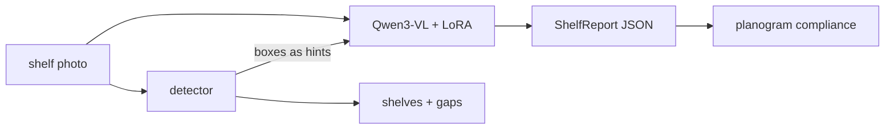

# shelf-vlm

[](https://github.com/yogesh660/shelf-vlm/actions/workflows/ci.yml)

Shelf photo in, retail-audit report out: products and facings per shelf, empty slots, share of
shelf by brand and a planogram compliance score, as JSON a downstream system can trust.

Status: **M0** - the output contract and everything that works on it (shelf rows, gap finding,
compliance, metrics, dataset loader, VLM client) is in place and tested. Models come next;
see the [roadmap](docs/ROADMAP.md).

```
$ make demo
shelf_a.jpg: 25 products on 3 shelves
  shelf 0:  10 products, 0 gap(s)
  shelf 1:   8 products, 1 gap(s)
  shelf 2:   7 products, 1 gap(s)
compliance 79%  (5 issue(s))
  shelf 0: 7/8 planned facings  missing {'Pantene': 1}; misplaced {'Sunsilk': 1}; extra {'Sunsilk': 1}
  shelf 1: 5/6 planned facings  missing {'Sunsilk': 1}
  shelf 2: 3/5 planned facings  missing {'Garnier': 2}
```

## Why a detector and a VLM

Retail audits need exact counts and positions, and they need someone to read the labels.
Detectors count dense shelves well but don't know brands; vision-language models read brands
and reason about layout but miscount dozens of similar packs. This project uses both and
measures each alone and combined ([ADR 0001](docs/adr/0001-detector-plus-vlm.md)).



## Quickstart

Needs [uv](https://docs.astral.sh/uv/).

```bash
git clone https://github.com/yogesh660/shelf-vlm && cd shelf-vlm
make setup     # core package + dev tools, no ML frameworks
make check     # lint, mypy, tests
make demo      # works offline, no data or GPU
make schema    # the JSON schema the VLM answers in
```

Ask any OpenAI-compatible vision model about a photo (vLLM, Ollama, a hosted API):

```bash
export SHELF_VLM_BASE_URL=http://localhost:8000/v1 SHELF_VLM_MODEL=Qwen/Qwen3-VL-8B-Instruct
uv run shelf analyse my_shelf.jpg
```

The reply is validated against `ShelfReport`; if it's invalid, the model gets the validation
error and one more try ([ADR 0002](docs/adr/0002-structured-output.md)).

## What's in the core

| Module | Does |
|---|---|
| [`schema.py`](src/shelf/schema.py) | `ShelfReport`: shelves, products with facings, gaps; share of shelf. Closed schema, cross-field checks |
| [`rows.py`](src/shelf/rows.py) | groups detector boxes into shelves, finds empty slots between and at the ends of rows |
| [`planogram.py`](src/shelf/planogram.py) | compliance per shelf: missing, extra, misplaced (right product, wrong shelf), block order |
| [`metrics.py`](src/shelf/metrics.py) | IoU box matching (P/R/F1), counting error per brand |
| [`vlm.py`](src/shelf/vlm.py) | prompt, standard-library OpenAI-compatible client, validate + retry |
| [`data/sku110k.py`](src/shelf/data/sku110k.py) | SKU-110K download and annotation parsing |

All of it is plain Python + pydantic, so it runs and is tested without a GPU. A repo check
keeps ML frameworks out of the core.

## Data

- **SKU-110K** (Goldman et al., CVPR 2019): 11,743 shelf images with product boxes, no brand
  labels. `make data` downloads it (about 13.6 GB). Research use; see the
  [original repository](https://github.com/eg4000/SKU110K_CVPR19) for terms.
- **Own photos** (M2): labelled with brand, category and gaps. Not published.

## Working in this repo

[`CLAUDE.md`](CLAUDE.md) has the layout, commands and rules for anyone changing the code,
human or coding agent. `make check` is what CI runs.

## License

MIT
