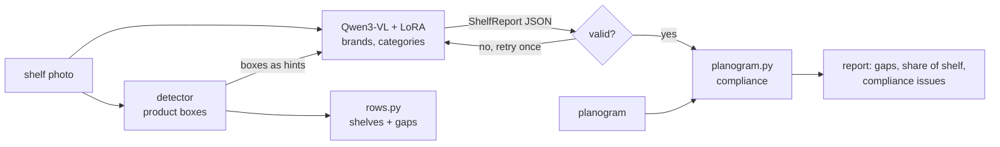
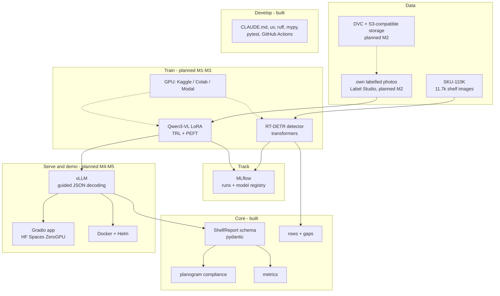

# shelf-vlm

[](https://github.com/yogesh660/shelf-vlm/actions/workflows/ci.yml)

**Case study page:** [yogesh660.github.io/shelf-vlm](https://yogesh660.github.io/shelf-vlm/)

Shelf photo in, retail-audit report out: products and facings per shelf, empty slots, share of
shelf by brand and a planogram compliance score, as JSON a downstream system can trust.

**In 30 seconds:** a detector counts the products, a fine-tuned vision-language model reads
the brands, and plain, tested code turns both into the numbers a retail audit needs. The
model must answer in a fixed JSON schema, so its output can feed a dashboard or an alert
without anyone checking it by hand.

Status: **M0** - the output contract and everything that works on it (shelf rows, gap
finding, compliance, metrics, dataset loader, VLM client) is built and tested. Model training
comes next; see the [roadmap](docs/ROADMAP.md).

```
$ make demo
shelf_a.jpg: 25 products on 3 shelves
  shelf 0:  10 products, 0 gap(s)
  shelf 1:   8 products, 1 gap(s)
  shelf 2:   7 products, 1 gap(s)
compliance 79%  (5 issue(s))
  shelf 0: 7/8 planned facings  missing {'Pantene': 1}; misplaced {'Sunsilk': 1}; extra {'Sunsilk': 1}
  shelf 1: 5/6 planned facings  missing {'Sunsilk': 1}
  shelf 2: 3/5 planned facings  missing {'Garnier': 2}
```

## The problem

Consumer-goods brands pay for shelf space and agree with retailers how their products should
be placed: which shelf, how many facings, next to what. This plan is the *planogram*. Whether
the shelf actually looks like that decides sales: an empty slot is a lost sale, and a product
on the wrong shelf sells less.

Today this is mostly checked by field reps who visit stores, count by eye or with a phone app,
and file a report. It is slow, expensive and only covers a sample of stores and days. The
questions are always the same:

- Is anything **out of stock**, and where?
- What is our **share of shelf** compared to competitors?
- Does the shelf **comply with the planogram**, and if not, what is wrong?

Photos are cheap to take. Turning a photo into those answers reliably is the hard part.

## How this project solves it

**Split the job by what each model is good at.** Shelves are dense: SKU-110K
averages around 150 products per photo. Object detectors count dense, similar objects well but don't know brands.
Vision-language models (VLMs) read brand names and understand layout but miscount dozens of
similar packs. The project uses both: the detector finds product boxes, the VLM reads them,
and each is measured alone and combined ([ADR 0001](docs/adr/0001-detector-plus-vlm.md)).

**Put business logic in code, not in the model.** Shelf rows, gaps, share of shelf and
planogram compliance are computed by plain Python from the model's output. That logic is
deterministic, unit tested and easy to explain to a category manager.

**Force a contract on the model.** The VLM must answer in the `ShelfReport` JSON schema
(guided decoding in vLLM), and the answer is validated again before use; an invalid answer
gets one retry with the error shown to the model ([ADR 0002](docs/adr/0002-structured-output.md)).

**Fine-tune only where it pays.** Start with zero-shot baselines, then LoRA fine-tune the VLM
on labelled shelf photos and report the gain on every metric.

## Design principles

1. **Models perceive, code decides.** Models detect and read; counting rules, gaps and
   compliance are code. When a number is wrong, you can tell which part was wrong.
2. **A contract between model and system.** `ShelfReport` is the single definition of the
   output: the VLM's JSON schema, the training target and the evaluation format.
3. **Baselines first.** A rule-based gap finder exists before any model is trained, so every
   model has something concrete to beat.
4. **Runs without a GPU until it needs one.** The core is plain Python and pydantic, tested on
   a laptop and in CI. Training and serving live behind optional extras.
5. **Clean licences.** MIT code, Apache-2.0 detector (RT-DETR) instead of AGPL YOLO
   ([ADR 0003](docs/adr/0003-detector-licence.md)).

### Trade-offs and what's out of scope

- **Two models instead of one.** More to train and serve, in exchange for reliable counts.
- **Facings, not shelf length.** Share of shelf is measured in facings, the common audit
  definition; measuring shelf length needs camera calibration and is out of scope.
- **No product-level SKU matching.** Brand and category, not exact SKU and pack size. SKU
  recognition needs a product catalogue with reference images.
- **Not a product.** No store app or retailer integration; the point is a reliable,
  measurable perception and reporting pipeline.

## How it works



1. The **detector** returns a box per product.
2. **`rows.py`** groups boxes into shelves by height and marks empty slots: horizontal space
   wider than a typical product, between products or at the ends of a shelf.
3. The **VLM** gets the photo (and in the hybrid setup the boxes) and returns a `ShelfReport`:
   brands, categories, facings and gaps per shelf.
4. **`planogram.py`** compares the report with the planned layout, shelf by shelf: missing
   facings, extra facings, misplaced products (right product, wrong shelf) and block order.

## Tech stack

Built now (M0) and planned (M1-M5, see the [roadmap](docs/ROADMAP.md)):



| Layer | Choice | Why this |
|---|---|---|
| Vision-language model | **Qwen3-VL** (8B, 4B for the demo) | strong open VLM family, reads small text on packs, documented LoRA fine-tuning, fits one GPU |
| Fine-tuning | **TRL SFT + PEFT LoRA/QLoRA** | trains adapters on a single 24-48 GB GPU; adapters are small to store and swap |
| Detector | **RT-DETR** via Hugging Face transformers | counts dense shelves; Apache-2.0; same training stack as the VLM |
| Output contract | **pydantic `ShelfReport`** + **guided decoding** in vLLM | one schema for output, training target and evaluation; invalid JSON never reaches a user |
| Business logic | **plain Python** (rows, gaps, compliance, metrics) | deterministic, unit tested, explainable to non-technical stakeholders |
| Data | **SKU-110K** + own labelled photos, **Label Studio**, **DVC** | public data for detection; own data for brands; data versioned next to code |
| Experiment tracking | **MLflow** | before/after numbers for every run; adapters in a model registry |
| Serving | **vLLM** | high-throughput VLM serving, OpenAI-compatible API, LoRA adapters, guided JSON |
| Demo | **Gradio** on **Hugging Face Spaces (ZeroGPU)** | free or $9/month GPU demo that embeds in a website |
| Engineering | **uv, ruff, mypy strict, pytest, GitHub Actions, CLAUDE.md** | reproducible, checked, and safe for coding agents to work in |

### Running it on GCP, AWS or Azure

The open-source stack runs anywhere. With managed services, the closest equivalents are:

| Need | Open-source default | Google Cloud | AWS | Azure |
|---|---|---|---|---|
| Image and label storage | S3-compatible bucket + DVC | Cloud Storage | Amazon S3 | Azure Blob Storage |
| Labelling | Label Studio | Label Studio on Cloud Run or GKE (Google's managed labelling service was shut down in 2024) | SageMaker Ground Truth | Azure Machine Learning data labelling |
| GPU training jobs | Kaggle / Colab / Modal | Vertex AI custom training (Gemini Enterprise Agent Platform) | SageMaker AI training jobs (managed spot) | Azure Machine Learning jobs on GPU clusters |
| Experiment tracking + registry | MLflow | Vertex AI Experiments + Model Registry | SageMaker AI managed MLflow + Model Registry | Azure Machine Learning (MLflow-compatible) |
| VLM serving | vLLM | vLLM on GKE or Vertex AI endpoints | vLLM on SageMaker AI endpoints or EKS | vLLM on AKS or Azure Machine Learning managed online endpoints |
| Hosted alternative to own VLM | - | Gemini models | Amazon Bedrock models | Azure OpenAI in Microsoft Foundry |
| App / API | Gradio, FastAPI in Docker | Cloud Run (GPU available) | ECS on Fargate, or ECS Express Mode | Azure Container Apps (serverless GPU available) |
| Kubernetes | Helm chart | GKE | Amazon EKS | AKS |
| CI/CD | GitHub Actions | GitHub Actions or Cloud Build | GitHub Actions or CodePipeline/CodeBuild | GitHub Actions or Azure Pipelines |

Switching to a hosted model only means pointing `SHELF_VLM_BASE_URL` at an OpenAI-compatible
endpoint; the schema validation and everything downstream stay the same.

## Quickstart

Needs [uv](https://docs.astral.sh/uv/).

```bash
git clone https://github.com/yogesh660/shelf-vlm && cd shelf-vlm
make setup     # core package + dev tools, no ML frameworks
make check     # lint, mypy, tests
make demo      # works offline, no data or GPU
make schema    # the JSON schema the VLM answers in
```

Ask any OpenAI-compatible vision model about a photo (vLLM, Ollama, a hosted API):

```bash
export SHELF_VLM_BASE_URL=http://localhost:8000/v1 SHELF_VLM_MODEL=Qwen/Qwen3-VL-8B-Instruct
uv run shelf analyse my_shelf.jpg
```

## What's in the core

| Module | Does |
|---|---|
| [`schema.py`](src/shelf/schema.py) | `ShelfReport`: shelves, products with facings, gaps; share of shelf. Closed schema, cross-field checks |
| [`rows.py`](src/shelf/rows.py) | groups detector boxes into shelves, finds empty slots between and at the ends of rows |
| [`planogram.py`](src/shelf/planogram.py) | compliance per shelf: missing, extra, misplaced (right product, wrong shelf), block order |
| [`metrics.py`](src/shelf/metrics.py) | IoU box matching (P/R/F1), counting error per brand |
| [`vlm.py`](src/shelf/vlm.py) | prompt, standard-library OpenAI-compatible client, validate + retry |
| [`data/sku110k.py`](src/shelf/data/sku110k.py) | SKU-110K download and annotation parsing |

## How it will be measured

| Metric | Answers |
|---|---|
| Count MAE / MAPE | are products per shelf and per brand counted correctly? |
| Gap precision / recall | are empty slots found, without false alarms? |
| Share-of-shelf error | are brand shares close to the labelled truth? |
| Compliance F1 | are missing, extra and misplaced products found? |
| JSON validity rate | how often is the model's answer usable as-is? |
| Latency per image | is it fast enough for an app in the store? |

Each is reported for: zero-shot VLM, fine-tuned VLM, detector + rules, detector + fine-tuned VLM.

## Data

### Synthetic-gap baseline (M1 in progress)

Run the annotation-only evaluator without downloading images or loading a model:

```bash
uv run shelf eval-gaps tests/fixtures/annotations_mini.csv --seed 0
uv run shelf eval-gaps data/sku110k/SKU110K_fixed/annotations/annotations_test.csv --seed 0
```

For each image, the evaluator chooses one interior product from rows containing at least
three boxes, removes it, reruns row grouping and gap finding, and matches predicted gaps
against the removed box at IoU >= 0.5. Image names are sorted before seeded sampling.
JSON output includes evaluated/skipped images, TP/FP/FN and micro precision/recall/F1;
an input with no eligible images returns a nonzero exit status. `--iou` changes the match
threshold. No output-schema fields or gap-finder thresholds are changed.

This measures synthetic removal recovery using ground-truth product boxes. Natural gaps
are not labelled in SKU-110K and count as false positives here; row-height boxes and
merged gaps can also reduce IoU. These numbers are not real-world gap precision or
detector accuracy. Full test-split results remain pending a dataset run.

Fixture smoke result (`annotations_mini.csv`, seed 0, IoU 0.5): 2 evaluated images,
2 TP / 2 FP / 0 FN; precision 0.500, recall 1.000, F1 0.667. This tiny fixture checks
the evaluation path only and is not a benchmark result.

### RT-DETR baseline (M1 in progress)

The training entry point consumes the existing SKU-110K layout and fine-tunes the
single-class RT-DETR checkpoint. Training images stay under the ignored `data/` directory;
checkpoints and prediction files stay under ignored `outputs/`.

```bash
uv sync --extra train
uv run python -m train.rtdetr train --data data/sku110k --output outputs/rtdetr-sku110k
uv run python -m train.rtdetr predict \
  --model outputs/rtdetr-sku110k \
  --annotations data/sku110k/SKU110K_fixed/annotations/annotations_test.csv \
  --images data/sku110k/SKU110K_fixed/images \
  --output outputs/rtdetr-test.csv
uv run shelf eval-detector \
  data/sku110k/SKU110K_fixed/annotations/annotations_test.csv \
  outputs/rtdetr-test.csv --score 0.5 --iou 0.5
```

The final command reports micro detection precision/recall/F1 and per-image count
MAE/MAPE. The checkpoint is initialized from `PekingU/rtdetr_r50vd`, uses 640x640 processor
inputs, and defaults to 10 epochs with effective batch size 16. Full metrics remain pending
the GPU run.

- **SKU-110K** (Goldman et al., CVPR 2019): 11,743 shelf images with product boxes, no brand
  labels. `make data` downloads it (about 13.6 GB). Research use; see the
  [original repository](https://github.com/eg4000/SKU110K_CVPR19) for terms.
- **Own photos** (M2): labelled with brand, category and gaps. Not published; no people in frame.

## Working in this repo

[`CLAUDE.md`](CLAUDE.md) has the layout, commands and rules for anyone changing the code,
human or coding agent. `make check` is what CI runs.

## License

MIT
