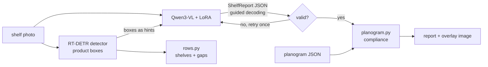

# Roadmap

Each milestone ends with something you can look at: numbers in the README, a demo, a PR.

Status: **M0 done** (2026-10-27)

## Target architecture

## Stack

| Need | Choice | Why |
|---|---|---|
| VLM | Qwen3-VL 8B (4B for the hosted demo) | strong open VLM family with documented LoRA fine-tuning; fits one GPU |
| Fine-tuning | TRL SFT + PEFT LoRA/QLoRA (Unsloth if memory is tight) | single 24-48 GB GPU |
| Detector | RT-DETR via transformers | Apache-2.0, same training stack as the VLM (ADR 0003) |
| Output contract | pydantic `ShelfReport`, guided decoding in vLLM | invalid JSON never reaches a user (ADR 0002) |
| Labelling | Label Studio | boxes + brand attributes for own photos |
| Data versioning | DVC, S3-compatible remote | own photos and labels versioned next to code |
| Tracking | MLflow | runs, adapters in the registry |
| Serving | vLLM (production), transformers on HF ZeroGPU (demo) | |
| UI | Gradio | upload, overlay, JSON, Q&A; embeds in a website |

## Milestones

### M0 - Skeleton (done)
- [x] uv project, CLAUDE.md harness, Makefile, CI, repo self-checks
- [x] `ShelfReport` output contract with a closed JSON schema
- [x] Rule-based shelf rows and gap finder on detector boxes (the non-VLM baseline)
- [x] Planogram compliance scoring: missing, extra, misplaced, order
- [x] Metrics: IoU box matching, counting error
- [x] SKU-110K download and annotation parsing
- [x] VLM client for any OpenAI-compatible server, with validation and one retry

### M1 - Baselines
- Annotation-only synthetic-gap evaluator implemented (`shelf eval-gaps`); full SKU-110K
  test-split run and recorded results pending. See README for the protocol and limitations.
- RT-DETR training, prediction and detector-evaluation entry points implemented; full dataset
  download, GPU training and test-split metrics pending.
- [ ] Gap finder evaluated on SKU-110K ground-truth boxes (precision/recall with synthetic gaps
  made by removing boxes)
- [ ] RT-DETR fine-tuned on SKU-110K; detection P/R/F1 and count MAE on the test split
- [ ] Zero-shot Qwen3-VL on a sample of shelves: JSON validity rate, count error vs ground truth
- [ ] Results logged to MLflow, table in README

### M2 - Own data
- [ ] 150-300 shelf photos (no people), labelled with brand, category, gaps in Label Studio
- [ ] DVC for photos and labels
- [ ] Synthetic planograms from labelled photos with controlled changes (removed, swapped,
  moved products), so compliance has ground truth
- [ ] Training conversations generated from labels; fixed train/val/test split

### M3 - Fine-tune
- [ ] LoRA SFT of Qwen3-VL on the training conversations
- [ ] Before/after on every metric; adapter registered in MLflow
- [ ] Error analysis by shelf density, lighting and angle

### M4 - Hybrid and structured output
- [ ] Detector boxes passed to the VLM as hints; compare VLM alone, detector alone, both
- [ ] Guided JSON decoding in vLLM; validity rate before/after
- [ ] Overlay image: products, gaps and compliance issues drawn on the photo

### M5 - Demo and deployment
- [ ] Gradio app (4B model on ZeroGPU) with cached example results
- [ ] vLLM endpoint on Modal with the adapter, scales to zero
- [ ] Docker images, Helm chart

## Evaluation

| Metric | Task |
|---|---|
| Count MAE / MAPE | products per shelf and per brand |
| Gap precision / recall | empty slots |
| Share-of-shelf error | brand shares vs labels |
| Compliance F1 | missing / misplaced / extra vs planogram ground truth |
| JSON validity rate | before and after guided decoding |
| Latency per image | demo and production profiles |

Reported for: zero-shot VLM, fine-tuned VLM, detector + rules, detector + fine-tuned VLM.

## Demo and hosting

| Level | What | Cost |
|---|---|---|
| Always works | website page: video, before/after table, example shelves with overlays | $0 |
| Live | Gradio Space on ZeroGPU, 4B model + adapter, bundled examples with cached results | $0, or $9/month for HF PRO quota |
| Production path | vLLM on Modal with the 8B adapter, scales to zero | within Modal's free credits for demo use |

## Compute budget (estimate)

- Detector fine-tune: a few GPU hours (Kaggle's free GPU is enough).
- VLM LoRA on a few thousand image-conversation pairs: roughly 3-8 hours on an L4/A10-class
  GPU, around $5-20 on Modal.

## Risks

- Store photography: ask permission or use cooperating small shops; never people in frame.
- VLM counting degrades on very dense shelves; that is why the detector stays (ADR 0001).
- Brand packaging in published examples: keep the dataset private if needed and publish
  metrics and a few approved examples.
- SKU-110K is for research use; check its terms before any other use.
